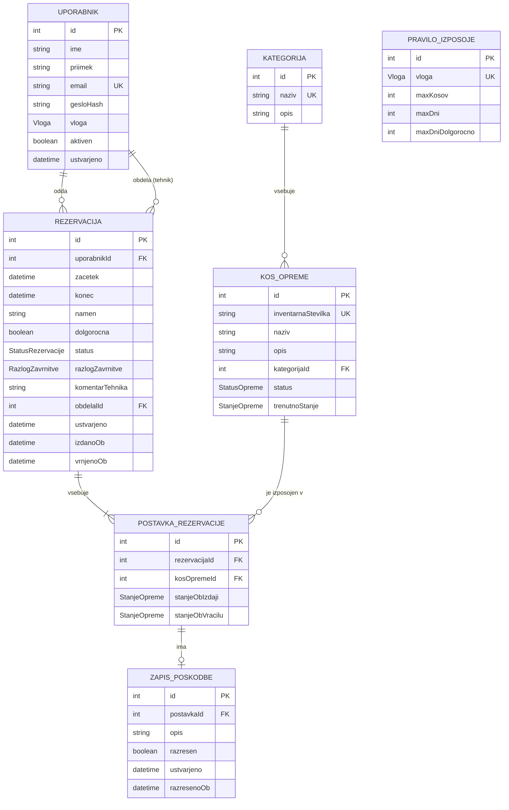
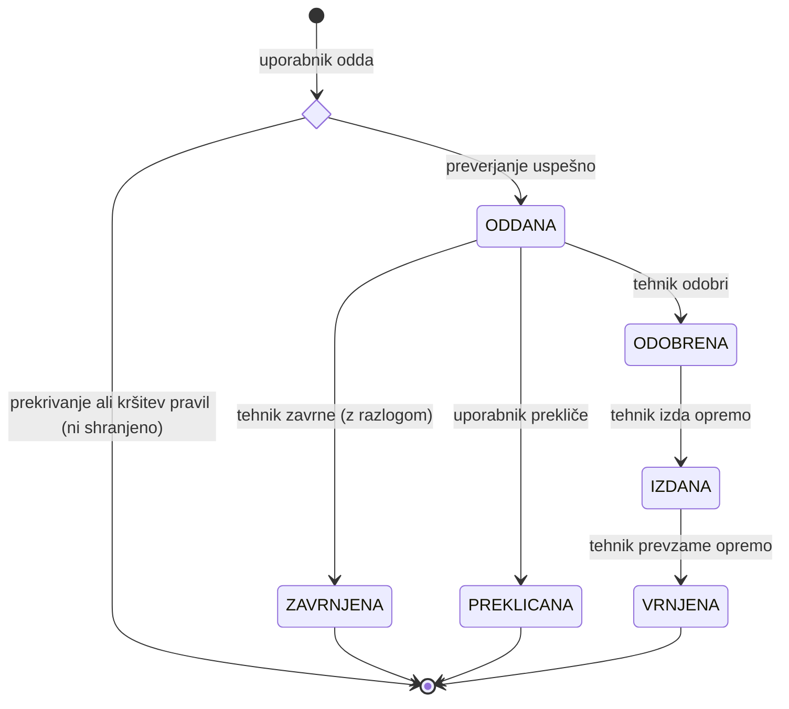

# Podatkovni model

Rešitev uporablja relacijsko podatkovno bazo **PostgreSQL**. Shema je opisana s **Prisma** (`schema.prisma`), iz katere se ustvarijo tabele in migracije.

## Entitete

### Uporabnik

Vsi uporabniki sistema, ne glede na vlogo.

| Polje | Tip | Opis |
|---|---|---|
| `id` | int, PK | Enolični identifikator |
| `ime` | string | Ime |
| `priimek` | string | Priimek |
| `email` | string, unikaten | E-poštni naslov, uporablja se za prijavo |
| `gesloHash` | string | Geslo, zgoščeno z bcrypt |
| `vloga` | enum `Vloga` | `STUDENT`, `ASISTENT`, `PROFESOR`, `TEHNIK`, `ADMIN` |
| `aktiven` | boolean | Deaktiviran uporabnik se ne more prijaviti |
| `ustvarjeno` | datetime | Datum ustvarjanja računa |

### Kategorija

Skupina opreme, npr. »Mikrokrmilniki«, »Merilni instrumenti«, »Foto/video oprema«.

| Polje | Tip | Opis |
|---|---|---|
| `id` | int, PK | Enolični identifikator |
| `naziv` | string, unikaten | Ime kategorije |
| `opis` | string, neobvezno | Kratek opis |

### KosOpreme

Posamezen fizični kos opreme z lastno inventarno številko. Dva enaka Arduina sta dva ločena zapisa.

| Polje | Tip | Opis |
|---|---|---|
| `id` | int, PK | Enolični identifikator |
| `inventarnaStevilka` | string, unikaten | Številka z nalepke na opremi |
| `naziv` | string | Npr. »Arduino Uno R3« |
| `opis` | string, neobvezno | Podrobnosti, priložen pribor |
| `kategorijaId` | int, FK → Kategorija | Kategorija opreme |
| `status` | enum `StatusOpreme` | `NA_VOLJO`, `V_OKVARI`, `UMAKNJEN` |
| `trenutnoStanje` | enum `StanjeOpreme` | `BREZHIBNO`, `OBRABLJENO`, `POSKODOVANO` |

Polje `status` pove, ali je kos sploh na voljo za izposojo. Ali je v določenem terminu zaseden, se izračuna iz rezervacij.

### Rezervacija

Zahtevek uporabnika za izposojo ene ali več kosov opreme v določenem terminu.

| Polje | Tip | Opis |
|---|---|---|
| `id` | int, PK | Enolični identifikator |
| `uporabnikId` | int, FK → Uporabnik | Kdo si opremo izposoja |
| `zacetek` | datetime | Začetek izposoje |
| `konec` | datetime | Rok vračila |
| `namen` | string | Namen izposoje (npr. »projekt pri predmetu Vgrajeni sistemi«) |
| `dolgorocna` | boolean | Ali gre za dolgoročno izposojo (samo profesor) |
| `status` | enum `StatusRezervacije` | Glej spodaj |
| `razlogZavrnitve` | enum `RazlogZavrnitve`, neobvezno | Izpolnjen le pri zavrnitvi |
| `komentarTehnika` | string, neobvezno | Dodatna obrazložitev tehnika |
| `obdelalId` | int, FK → Uporabnik, neobvezno | Tehnik, ki je rezervacijo odobril ali zavrnil |
| `ustvarjeno` | datetime | Čas oddaje |
| `izdanoOb` | datetime, neobvezno | Dejanski čas prevzema |
| `vrnjenoOb` | datetime, neobvezno | Dejanski čas vračila |

### PostavkaRezervacije

Vmesna tabela, ki poveže rezervacijo s posameznimi kosi opreme (povezava več-proti-več). Hrani tudi stanje vsakega kosa ob izdaji in vračilu.

| Polje | Tip | Opis |
|---|---|---|
| `id` | int, PK | Enolični identifikator |
| `rezervacijaId` | int, FK → Rezervacija | Rezervacija |
| `kosOpremeId` | int, FK → KosOpreme | Izposojen kos |
| `stanjeObIzdaji` | enum `StanjeOpreme`, neobvezno | Zabeleži tehnik ob prevzemu |
| `stanjeObVracilu` | enum `StanjeOpreme`, neobvezno | Zabeleži tehnik ob vračilu |

Par (`rezervacijaId`, `kosOpremeId`) je unikaten – isti kos se v eni rezervaciji ne more pojaviti dvakrat.

### ZapisPoskodbe

Evidenca poškodbe, ki jo tehnik ugotovi ob vračilu. Vezana je na postavko rezervacije, zato je vedno znano, kateri kos je bil poškodovan in pri katerem uporabniku.

| Polje | Tip | Opis |
|---|---|---|
| `id` | int, PK | Enolični identifikator |
| `postavkaId` | int, FK → PostavkaRezervacije | Postavka, pri kateri je nastala poškodba |
| `opis` | string | Opis poškodbe |
| `razresen` | boolean | Ali je poškodba poravnana |
| `ustvarjeno` | datetime | Čas zapisa |
| `razresenoOb` | datetime, neobvezno | Čas razrešitve |

### PraviloIzposoje

Omejitve izposoje za posamezno vlogo, ki jih ureja administrator.

| Polje | Tip | Opis |
|---|---|---|
| `id` | int, PK | Enolični identifikator |
| `vloga` | enum `Vloga`, unikaten | Vloga, za katero pravilo velja |
| `maxKosov` | int | Največ kosov hkrati |
| `maxDni` | int | Najdaljši standardni čas izposoje |
| `maxDniDolgorocno` | int, neobvezno | Najdaljši čas dolgoročne izposoje (le za profesorja) |

Začetne vrednosti:

| Vloga | `maxKosov` | `maxDni` | `maxDniDolgorocno` |
|---|---|---|---|
| `STUDENT` | 3 | 7 | – |
| `ASISTENT` | 20 | 7 | – |
| `PROFESOR` | 20 | 7 | 180 |

## Naštevni tipi (enum)

- **Vloga:** `STUDENT`, `ASISTENT`, `PROFESOR`, `TEHNIK`, `ADMIN`
- **StatusOpreme:** `NA_VOLJO`, `V_OKVARI`, `UMAKNJEN`
- **StanjeOpreme:** `BREZHIBNO`, `OBRABLJENO`, `POSKODOVANO`
- **StatusRezervacije:** `ODDANA`, `ODOBRENA`, `ZAVRNJENA`, `PREKLICANA`, `IZDANA`, `VRNJENA`
- **RazlogZavrnitve:** `ZAMUJENA_IZPOSOJA`, `NEPORAVNANA_POSKODBA`, `OPREMA_V_OKVARI`, `POTREBNA_ZA_VAJE`, `NEUSTREZEN_NAMEN`

## Povezave med entitetami

| Povezava | Tip | Opis |
|---|---|---|
| Uporabnik → Rezervacija | 1 : N | Uporabnik ima lahko več rezervacij, vsaka rezervacija pripada enemu uporabniku. |
| Uporabnik (tehnik) → Rezervacija | 1 : N | Tehnik obdela več rezervacij (`obdelalId`). |
| Kategorija → KosOpreme | 1 : N | Kategorija vsebuje več kosov opreme. |
| Rezervacija ↔ KosOpreme | M : N | Prek tabele PostavkaRezervacije: rezervacija vsebuje več kosov, kos je skozi čas v več rezervacijah. |
| PostavkaRezervacije → ZapisPoskodbe | 1 : 0..1 | Postavka ima lahko največ en zapis o poškodbi. |
| PraviloIzposoje – Vloga | 1 : 1 | Za vsako vlogo obstaja največ eno pravilo. |

## Diagram entitet

## Življenjski cikel rezervacije

### Neuspešna oddaja rezervacije

Preden se rezervacija shrani, backend preveri prekrivanje terminov in pravila vloge (glej *Ključna pravila nad podatki*). Če preverjanje ne uspe, se rezervacija **ne shrani** in zato nikoli ne vstopi v življenjski cikel. To je ključna razlika v primerjavi z zavrnitvijo:

| | Neuspešna oddaja | Zavrnitev |
|---|---|---|
| Kdo odloči | sistem, samodejno | tehnik, ročno |
| Kdaj | ob oddaji | pri pregledu oddanih rezervacij |
| Zapis v bazi | ne nastane | ostane s statusom `ZAVRNJENA` in razlogom |
| Kaj vidi uporabnik | takojšnje sporočilo o napaki | razlog in komentar pri svoji rezervaciji |

**Primer:** študent želi kos *Arduino A-014* od 20. 10. do 24. 10. Ta kos je že v rezervaciji s statusom `ODOBRENA` od 22. 10. do 27. 10. Ker velja `20. 10. < 27. 10.` in `24. 10. > 22. 10.`, se termina prekrivata. Backend vrne napako **409 Conflict** s sporočilom »Arduino A-014 je zaseden od 22. 10. do 27. 10.«, v bazi pa ne nastane noben zapis. Študent lahko takoj izbere drug termin ali drug kos.

Ker že rezervacije s statusom `ODDANA` zasedejo termin, pri kasnejši odobritvi do prekrivanja ne more priti.

**Hkratna oddaja:** če dva uporabnika istočasno oddata rezervacijo za isti kos in termin, backend preverjanje in shranjevanje izvede v eni **transakciji**. Uspe le prva rezervacija, druga dobi napako 409.

### Zamujena izposoja

**Zamujena izposoja** ni ločen shranjen status, ampak se izračuna ob vsakem branju: rezervacija je zamujena, če ima status `IZDANA` in je `konec` manjši od trenutnega časa. Tako status vedno drži, ne da bi v ozadju tekel ločen proces. V uporabniškem vmesniku se takšna rezervacija prikaže kot *Zamujena*.

## Ključna pravila nad podatki

- **Prekrivanje terminov:** kos opreme ne sme biti v dveh rezervacijah s statusom `ODDANA`, `ODOBRENA` ali `IZDANA`, katerih termina se prekrivata. Termina se prekrivata, če velja `novZacetek < obstojeciKonec` in `novKonec > obstojeciZacetek`.
- **Omejitev kosov:** seštevek kosov v vseh aktivnih rezervacijah uporabnika (`ODDANA`, `ODOBRENA`, `IZDANA`) skupaj z novo rezervacijo ne sme preseči `maxKosov` za njegovo vlogo.
- **Omejitev časa:** razlika med `konec` in `zacetek` ne sme preseči `maxDni` oziroma `maxDniDolgorocno`, če je `dolgorocna = true`. Dolgoročno rezervacijo lahko odda le profesor.
- **Zavrnitev:** če ima rezervacija status `ZAVRNJENA`, mora biti `razlogZavrnitve` izpolnjen.
- **Trajna evidenca:** rezervacij, postavk in zapisov o poškodbah se ne briše. Kos opreme se ob odpisu označi kot `UMAKNJEN`, uporabnik pa kot neaktiven.
