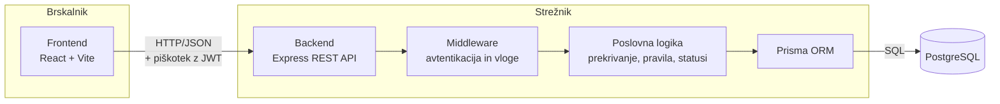

# Arhitektura in tehnološki sklad

## Arhitektura

Rentaj.me je spletna aplikacija s klasično tridelno arhitekturo: **frontend** v brskalniku, **backend** z REST API-jem in **podatkovna baza**.

### Glavni deli sistema

| Del | Naloga |
|---|---|
| **Frontend** (React) | Uporabniški vmesnik: katalog opreme, oddaja rezervacij, pregled lastnih izposoj, nadzorna plošča tehnika in administratorja. Ne vsebuje poslovne logike, le prikaz in osnovno preverjanje obrazcev. |
| **Backend** (Express) | REST API in vsa poslovna logika: preverjanje prekrivanja terminov, pravil vlog, prehodov med statusi rezervacij, izračun zamud, avtentikacija in avtorizacija. |
| **Podatkovna baza** (PostgreSQL) | Trajno shranjevanje uporabnikov, opreme, rezervacij, postavk, zapisov o poškodbah in pravil izposoje. Edini vir resnice v sistemu. |

### Diagram



### Komunikacija med deli sistema

- **Frontend ↔ backend:** frontend pošilja HTTP zahteve na REST API (`/api/...`), podatki se izmenjujejo v obliki **JSON**. Vsaka zahteva samodejno vsebuje piškotek z JWT žetonom (`credentials: 'include'`).
- **Backend ↔ baza:** backend do baze dostopa izključno prek **Prisma ORM**, ki poizvedbe pretvori v SQL. Frontend do baze nikoli ne dostopa neposredno.
- **Napake:** backend vrača ustrezne HTTP statusne kode, npr. `400` za neveljavne podatke, `401` za neprijavljenega uporabnika, `403` za premalo pravic, `404` za neobstoječ vir in `409` za prekrivanje terminov.

### Glavni API endpointi

| Metoda in pot | Opis | Dostop |
|---|---|---|
| `POST /api/auth/prijava` | Prijava, nastavi piškotek z JWT | vsi |
| `POST /api/auth/odjava` | Odjava, izbriše piškotek | prijavljeni |
| `GET /api/auth/jaz` | Podatki o prijavljenem uporabniku in vlogi | prijavljeni |
| `GET /api/oprema` | Katalog opreme z iskanjem in filtri | prijavljeni |
| `GET /api/oprema/:id/zasedenost` | Zasedeni termini kosa opreme | prijavljeni |
| `POST /api/rezervacije` | Oddaja rezervacije s preverjanjem pravil | študent, asistent, profesor |
| `GET /api/rezervacije/moje` | Lastne rezervacije | študent, asistent, profesor |
| `PATCH /api/rezervacije/:id/preklic` | Preklic oddane rezervacije | lastnik rezervacije |
| `GET /api/rezervacije` | Vse rezervacije s filtri (npr. oddane, zamujene) | tehnik, admin |
| `PATCH /api/rezervacije/:id/odobritev` | Odobritev | tehnik |
| `PATCH /api/rezervacije/:id/zavrnitev` | Zavrnitev z razlogom | tehnik |
| `PATCH /api/rezervacije/:id/izdaja` | Izdaja opreme in stanje ob izdaji | tehnik |
| `PATCH /api/rezervacije/:id/vracilo` | Vračilo, stanje in morebitna poškodba | tehnik |
| `/api/uporabniki`, `/api/kategorije`, `/api/pravila` | Upravljanje uporabnikov, kategorij in pravil | admin |

### Podatkovna baza

Uporabljamo relacijsko bazo **PostgreSQL**. Shema je definirana v `schema.prisma`, spremembe sheme pa se uvajajo z migracijami (`prisma migrate`). Začetni podatki (administrator, tehnik, pravila izposoje, nekaj kategorij in opreme) se naložijo s skripto `prisma/seed.js`.

Podroben opis entitet je v dokumentu [03-podatkovni-model.md](03-podatkovni-model.md).

### Avtentikacija in upravljanje uporabnikov

- **Uporabniške račune ustvarja administrator.** Javne registracije ni, saj sistem uporabljajo le člani oddelka.
- **Gesla** so shranjena kot zgoščene vrednosti z algoritmom **bcrypt**, nikoli v izvorni obliki.
- **Prijava:** backend preveri e-pošto in geslo ter ustvari podpisan **JWT** žeton z ID-jem in vlogo uporabnika. Žeton pošlje v **piškotku** z nastavitvami `httpOnly`, `sameSite: 'lax'` in v produkciji `secure`.
- **Preverjanje:** middleware ob vsaki zahtevi prebere piškotek, preveri podpis in veljavnost žetona ter v zahtevo zapiše podatke o uporabniku. Drugi middleware (`zahtevajVlogo('TEHNIK')`) preveri, ali ima uporabnik ustrezno vlogo za dani endpoint.
- **Frontend** žetona ne vidi. Ob zagonu aplikacije pokliče `GET /api/auth/jaz` in glede na vrnjeno vlogo prikaže ustrezne strani in menije.
- **Odjava:** backend izbriše piškotek.
- **Deaktiviran uporabnik** (`aktiven = false`) se ne more prijaviti.

Razvojni strežnik Vite ima nastavljen **proxy**, ki vse zahteve na `/api` posreduje backendu. Brskalnik tako komunicira le z enim naslovom, kar odpravi težave s CORS in piškotki.

### Struktura repozitorija

```
rentaj-me/
├── docs/                  # dokumentacija
├── frontend/              # React aplikacija
│   ├── src/
│   │   ├── pages/         # strani (Katalog, MojeIzposoje, Tehnik ...)
│   │   ├── components/    # komponente za večkratno uporabo
│   │   └── api/           # funkcije za klice API-ja
│   └── vite.config.js
├── backend/               # Express API
│   ├── src/
│   │   ├── routes/        # definicije endpointov
│   │   ├── middleware/    # avtentikacija, preverjanje vlog
│   │   └── services/      # poslovna logika (rezervacije, pravila)
│   └── prisma/
│       ├── schema.prisma
│       └── seed.js
├── docker-compose.yml
└── .env.example
```

## Tehnološki sklad

| Področje | Tehnologije in orodja |
|---|---|
| **Frontend** | React, Vite, React Router, Tailwind CSS |
| **Backend** | Node.js, Express, cookie-parser, Zod (preverjanje vhodnih podatkov) |
| **Podatkovna baza** | PostgreSQL, Prisma ORM |
| **Avtentikacija** | JWT (jsonwebtoken), bcrypt, piškotki httpOnly |
| **Lokalni razvoj** | Docker, Docker Compose, datoteke `.env`, Git in GitHub |

## Arhitekturne odločitve

| Odločitev | Utemeljitev |
|---|---|
| **Ločen frontend in backend (React + Express)** | Jasna delitev odgovornosti: frontend skrbi za prikaz, backend za pravila. Backend je mogoče kasneje uporabiti tudi za druge odjemalce (npr. mobilno aplikacijo ali skener QR kod). |
| **Vsa poslovna logika na backendu** | Pravil, kot sta prekrivanje terminov in omejitve vlog, ni mogoče obiti s spreminjanjem kode v brskalniku. Frontend preverjanje je le za boljšo uporabniško izkušnjo. |
| **REST API z JSON** | Preprost, razširjen in dobro podprt pristop, ki zadošča za obseg aplikacije. |
| **Relacijska baza PostgreSQL** | Podatki so močno povezani (uporabnik, rezervacija, postavka, kos opreme). Relacijska baza zagotavlja tuje ključe, unikatnost in transakcije, ki so ključne za preprečevanje dvojnih rezervacij. |
| **Prisma ORM** | Shema na enem mestu, samodejne migracije in varne poizvedbe brez ročnega pisanja SQL. Zmanjša možnost napak in olajša spreminjanje modela. |
| **Preverjanje in shranjevanje rezervacije v eni transakciji** | Prepreči, da bi dva uporabnika, ki rezervacijo oddata hkrati, dobila isti kos opreme v istem terminu. |
| **Status »zamujena« se izračuna, ne shrani** | Status je vedno točen, ne potrebujemo procesa, ki bi v ozadju periodično posodabljal bazo, in implementacija je preprostejša. |
| **JWT v piškotku httpOnly** | Žeton ni dostopen JavaScriptu, zato ga ni mogoče ukrasti z vrinjeno skripto (XSS). `sameSite: 'lax'` ščiti pred napadi CSRF. JWT omogoča, da strežniku ni treba hraniti sej. |
| **Brez javne registracije** | Sistem je namenjen le članom oddelka, zato račune ustvarja administrator. To prepreči dostop zunanjih oseb brez integracije s fakultetnim sistemom (ta je izven obsega). |
| **Pravila izposoje v bazi** | Administrator lahko omejitve spreminja brez sprememb v kodi. |
| **Docker Compose za lokalni zagon** | Vsi razvijalci imajo enako okolje, celoten sistem z bazo vred pa se zažene z enim ukazom. |
| **Proxy v Vite** | Frontend in backend sta za brskalnik na istem naslovu, kar poenostavi delo s piškotki in odpravi težave s CORS. |
